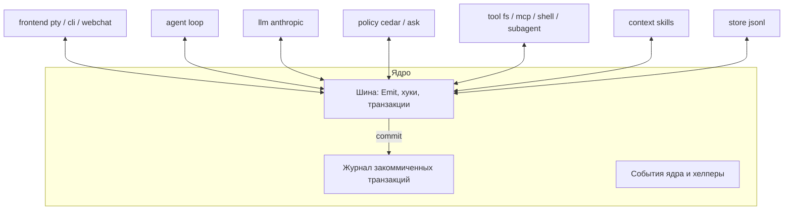
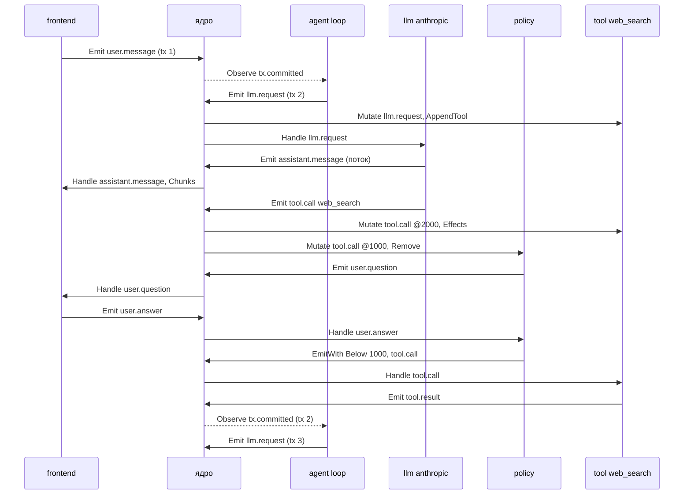

# aish: архитектура и план MVP

## 1. Цель

`aish` — агент-харнесс на Go, в котором **любая функция — модуль**, а модули взаимозаменяемы. Ориентир по расширяемости — Emacs: плагин может изменить поведение, которое авторы ядра не предусмотрели, а не только реализовать заранее заданную роль.

Критерий, по которому проверяем дизайн: **у ядра нет привилегированного поведения, которое нельзя заменить модулем**. Даже агентный цикл — обычный модуль.

Базовая поставка (все модули опциональны):

| Модуль | Что делает |
|---|---|
| `agent loop` | агентный цикл: ход → LLM → tool calls → LLM … |
| `frontend pty` | прокси над bash пользователя: видит команды и вывод, выполняет команды агента в живом шелле (**после MVP**) |
| `frontend cli` | простой REPL (эталон для проверки заменяемости фронтенда) |
| `llm anthropic` | провайдер Anthropic |
| `tool fs_read`, `tool fs_edit` | чтение и правка файлов |
| `tool bash` | выполнение команды через `bash -c` |
| `context system_prompt` | секция `base` системного промпта |
| `tool mcp` | MCP-серверы как источники tools |
| `policy cedar` | политики на Cedar |
| `policy ask` | простая политика по умолчанию |
| `context skills` | Agent Skills |
| `subagents core` | tool `task`: вызов другого агента из Agentfile |
| `subagents communication` | tools `send_message` и `list_agents`: обмен сообщениями между запущенными агентами |
| `store jsonl` | сохранение и восстановление сессий |

## 2. Принципы

1. **Статическая сборка, как в Caddy.** Плагины подключаются blank-импортом и регистрируются в `init()`. Бинарь пересобирается утилитой `aish-build` (аналог `xcaddy`). Go `plugin` (.so) не используем: он требует совпадения версий Go и всех зависимостей и не работает на Windows.
2. **Ядро — это тулинг и общие типы.** Логики агента в ядре нет. В нём только шина событий с транзакциями, журнал закоммиченных транзакций, реестр модулей, разбор конфига (`aish.LoadConfig`; всё, что в конфиге что-то значит, добавляют модули, §7), типы событий самого ядра и хелперы для модулей. Общие типы событий агента (§5) вынесены в пакет `events`: он импортирует `aish`, ядро о нём не знает. Хелперы, которым хватает публичного API, живут в отдельных пакетах, например сборка `messages` из журнала в пакете `transcript` (§4.7). Всё остальное — модули.
3. **У всех модулей один интерфейс.** Ролей вида `Frontend`/`Tool`/`Policy` нет. Модуль в `Init` подписывается на события, и этим определяется, что он делает. Один модуль может делать много вещей: `frontend pty` отвечает за ввод, вывод, tool `shell`, контекст терминала и вопросы пользователю.
4. **Модули общаются только через события ядра.** Прямых вызовов между модулями нет: ни запросов к модели, ни подтверждений, ни стриминга токенов. Модуль знает типы событий, а не другие модули.
5. **Журнал — это последовательность закоммиченных транзакций.** Закоммиченная транзакция неизменяема, журнал только дописывается. Пока транзакция не закоммичена, её события можно менять, удалять и порождать новые.
6. **Одна механика для всего: три режима хуков и числовой приоритет** (§4.4). Политики, нормализация аргументов, выполнение tools, UI и аудит устроены одинаково.
7. **Необработанное событие — ошибка отправителя.** Если событие не дошло ни до одного обработчика, `Emit` возвращает ошибку, а отправитель сам решает, важно ли это.
8. **Всё наблюдаемо.** Каждая транзакция хранит trace: какие хуки получили, изменили, удалили и породили какие события. модуль `log.trace` (функция `trace.Write`) его пишет в файл: дерево, в котором события, порождённые хуком, стоят под ним.
9. **Модель доверия.** Все модули в бинаре — доверенный код. Политики ограничивают модель, а не плагины: плагин может подписаться раньше политики, и это его право.

## 3. Обзор



Стрелок между модулями нет намеренно: любая связь идёт через шину. Вот как модули участвуют в работе агента:

- **фронтенд** порождает `user.message`, показывает поток `assistant.message` и отвечает на `user.question`;
- **`agent loop`** наблюдает `tx.committed` и решает, нужен ли следующий `llm.request`;
- **LLM-провайдер** обрабатывает `llm.request`, порождает `assistant.message` и `tool.call`;
- **tools** добавляют себя в `llm.request` и выполняют свои `tool.call`;
- **политика** перехватывает `tool.call` раньше tools;
- **store** записывает каждую закоммиченную транзакцию.

## 4. Ядро

Ядро — пакет `aish` в корне Go-модуля `github.com/GoldenDeals/aish-core`. Тестовые хелперы лежат в пакете `test` того же модуля.

### 4.1 Модуль и жизненный цикл

```go
package aish

type Module interface {
    Init(ctx context.Context, h *Host) error // единственный обязательный метод
}

// Опциональные интерфейсы:
type CaddyfileUnmarshaler interface { UnmarshalCaddyfile(d *caddyfile.Dispenser) error }
type Validator interface { Validate() error }                 // проверка конфига без побочных эффектов
type Starter   interface { Start(ctx context.Context) error } // долгоживущие: pty, mcp, webchat
type Stopper   interface { Stop(ctx context.Context) error }

type ModuleInfo struct {
    ID  string        // "<namespace>.<name>", например "frontend.pty"
    New func() Module
}
func RegisterModule(info ModuleInfo)
```

`UnmarshalCaddyfile` получает только свою директиву. `Dispenser` стоит на её первом токене (`llm anthropic fast { ... }`) и ограничен её блоком, весь Agentfile модулю не виден. Общие опции модуль читает через `h.Options()`.

Жизненный цикл сессии:

Жизненный цикл сессии задаёт публичный тип `Session`. Загрузчик конфига (этап 1) и тесты создают сессию из уже созданных экземпляров модулей:

```go
func NewSession(cfg SessionConfig) (*Session, error) // SessionConfig: ID, Agent, Parent, Depth, Instances []Instance{Name, Module}, Agents []AgentSpec, Log, StreamTimeout, Options, Spawner
func (s *Session) Start() error
func (s *Session) Emit(ctx context.Context, evs ...Event) error // новая транзакция сессии, ждёт коммита; `ctx` только ограничивает ожидание
func (s *Session) Wait(ctx context.Context) error    // ждёт простоя (§4.8)
func (s *Session) Close(ctx context.Context) error
func (s *Session) Journal() *Journal
func (s *Session) Info() SessionInfo
```

1. Для каждой директивы блока агента выполняются `New` → `UnmarshalCaddyfile` (загрузчик конфига), затем `NewSession` проверяет имена экземпляров и вызывает `Validate`. Ошибка конфига проявляется до каких-либо побочных эффектов.
2. `Start` вызывает `Init` у всех модулей в порядке конфига: подписка на события. Модуль восстановления в этот момент может заполнить журнал (`h.Seed`, §4.8). `Emit` с `ctx` из `Init` возвращает `ErrNotStarted`.
3. Запускается шина, затем `Start` у модулей, которым он нужен. `ctx` из `Start` живёт до `Close`, и `Emit` с ним работает уже внутри `Start`. Когда все `Start` прошли, ядро ставит в очередь `session.started`. Первой транзакцией она быть не обязана: горутина из `Start` может успеть раньше. Восстановленная сессия тоже получает свой `session.started`.
4. `Close` отменяет открытую транзакцию и ждёт её коммита (со статусом `cancelled`), транзакции из очереди получают `ErrClosed`. Потом `Stop` вызывается в обратном порядке у всех модулей, чей `Init` прошёл: модуль мог открыть ресурс уже в `Init`. Поэтому `Stop` должен работать и тогда, когда `Start` не вызывался. Если `Init` или `Start` вернул ошибку, `Session.Start` закрывает сессию тем же путём. Ожидание коммита ограничено `ctx` из `Close`: если хук игнорирует отмену, `Close` возвращает ошибку `ctx`, но всё равно вызывает `Stop`. Хук может вызвать `Close` со своим `ctx`: тогда ожидания нет, транзакция завершится, когда хук вернётся. Необязательный `SessionConfig.StreamTimeout` отменяет транзакцию с причиной `ErrStreamStalled`, если поток не закрыт вовремя.

Паника в `Validate`, `Init`, `Start` или `Stop` превращается в ошибку с именем экземпляра.

Сессия — это набор экземпляров модулей плюс журнал. Сабагент и восстановленная сессия создаются тем же путём: из блока Agentfile создаются свежие экземпляры (§4.8).

### 4.2 Host

`Host` — это всё, что ядро даёт модулю. Это **конкретный тип**, а не интерфейс. Причина в Go 1.27: generic-методы не могут объявляться в интерфейсах и не могут реализовывать интерфейсные методы. Так у всех модулей один и тот же API без альтернативных реализаций. Для тестов есть `test.NewSession(t, instances...)`: настоящая сессия с драйвером, который порождает события от имени теста (§10).

```go
type Host struct{ /* ... */ }

// Кто я
func (h *Host) Session() SessionInfo   // ID, агент ("main", "reviewer"), родительская сессия
func (h *Host) Instance() string       // экземпляр модуля: "llm.anthropic/fast"
func (h *Host) Log() *slog.Logger      // единый логгер модуля, см. «Логирование»
func (h *Host) Options() Options       // опции запуска: Resume (ID восстанавливаемой сессии); задаются в SessionConfig.Options
func (h *Host) Agent() AgentSpec       // блок конфига, который выполняет эта сессия: Name, Owner и Values — настройки по типам (aish.Get[T])
func (h *Host) Agents() []AgentSpec    // все блоки конфига; смысл их настроек знают только владеющие ими модули

// Подписка (§4.4)
func (h *Host) Mutate[E Event](name string, fn func(context.Context, *Mut[E]) error, opts ...HookOpt) Sub
func (h *Host) Handle[E Event](name string, fn func(context.Context, E) error, opts ...HookOpt) Sub
func (h *Host) Observe[E Event](name string, fn func(context.Context, E), opts ...HookOpt) Sub

// Порождение событий (§4.3)
func (h *Host) Emit(ctx context.Context, evs ...Event) error
func (h *Host) EmitWith(ctx context.Context, o EmitOpts, evs ...Event) error
func (h *Host) Cancel()                     // отменить открытую транзакцию и открытые транзакции всех сабагентов ниже (Ctrl+C)

// Чтение и интроспекция
func (h *Host) Journal() *Journal           // закоммиченные транзакции, только чтение
func (h *Host) Hooks[E Event]() []HookInfo  // кто подписан на E: имя, режим, приоритет

// Только в Init
func (h *Host) Seed(txs ...Tx) error        // §4.8

// Сессии
func (h *Host) Hold() (release func())  // не даёт Session.Wait вернуться, пока идёт фоновая работа модуля (сабагент); §4.8
func (h *Host) Spawn(ctx context.Context, agent string) (*Session, error) // §4.8

type Sub interface{ Remove() }              // отписка, например MCP при list_changed
```

`HookOpt` не generic: `aish.Priority(n)` должен подходить к любому `E`, а Go не выводит тип-параметр результата из места вызова. Тип фильтра `aish.Where(func(E) bool)` проверяется при подписке, несовпадение даёт панику.

**Логирование.** Модули пишут логи только через `h.Log()`. Это обычный `*slog.Logger`, а его handler настраивает ядро.
- Каждая запись содержит поля `session` и `instance`. Если писать через `*Context`-методы (`h.Log().InfoContext(ctx, ...)`) с `ctx` хука, добавляются ещё `tx`, `event` и `hook`. Это позволяет сопоставить лог с `log trace`.
- Записи получает `SessionConfig.Log`; без него они отбрасываются. Куда и с каким уровнем писать, задаёт глобальный конфиг (этап 1). По умолчанию записи идут в файл `~/.aish/logs/<session>.log`, а не в stdout/stderr: терминал принадлежит фронтенду, и логи не должны ломать его вывод.
- На уровне debug ядро пишет тела событий: `event emitted` (в момент порождения) и `event committed` (итог после Mutate-хуков и закрытия потоков) с атрибутом `payload` — JSON события, обрезанный до 64 КиБ (`aish.PayloadAttr`). Поэтому в debug-логе видны сообщения пользователя, аргументы и результаты tools, ответы ассистента. `llm.anthropic` дополнительно пишет полное тело запроса (`LLM request body`: system, tools, messages) и ответа (`LLM response body`) с токенами кэша, а модули контекста — собранный текст промпта. Лог с уровнем debug содержит содержимое файлов и переписку: хранить его нужно как секрет. На других уровнях тела не кодируются.
- Модули-tools пишут вызов (`running tool`) и успешное завершение (`tool finished`) с уровнем info, а ошибку выполнения (`tool failed`, `tool.result` с `is_error`) — с уровнем warn.
- Уровень можно будет переопределить для отдельного экземпляра модуля; это тоже часть конфига.
- Логи — это не события. Они не идут через шину и не попадают в журнал. Ошибки хуков, важные для сессии, остаются событиями `module.error`; кроме того, ядро пишет каждую такую ошибку в лог с уровнем error (вложенную, которая лишь передаёт сбой другого хука, — с уровнем debug), а `frontend cli` показывает её строкой `[error] <хук>: <текст>`.

### 4.3 События и транзакции

```go
type Event interface{ Kind() string } // "tool.call", "pty.command"; одинаков для всех значений типа

type Meta struct {
    ID     string    // присваивается при первом Emit и сохраняется при повторном
    Tx     uint64
    Time   time.Time
    Source string    // хук или экземпляр модуля, породивший событие
}
func MetaOf(ctx context.Context) Meta // метаданные текущего события внутри хука

type Envelope struct {
    Meta  Meta
    Event Event
}
```

Повторное порождение с тем же `Meta.ID` — это `Emit` события, обёрнутого в `Envelope`: политика сохраняет `Envelope{m.Meta(), *m.Event()}` и после одобрения вызывает `EmitWith(ctx, aish.Below(1000), env)`. `Tx`, `Time` и `Source` при этом назначаются заново. Идентификаторы событий имеют вид `<seq>.<n>`: они детерминированы, что удобно для golden-тестов.

Тип события — это любой тип, удовлетворяющий `Event`, регистрировать его не нужно. Имена общих типов ядра не имеют префикса (`tool.call`), а типы модулей начинаются с ID модуля (`pty.command`). Сериализации в ядре нет. Журнал на диске пишет и читает модуль сохранения, а ядро получает от него уже готовые `Tx` через `Seed` (§4.8). Декодирует событие владелец его типа: store читает из записи только `kind` и передаёт остальное в функцию декодирования владельца. Декодеры регистрируются по аналогии с `RegisterModule`: владелец типа вызывает в `init()` `aish.RegisterEvent[E]()`, а `aish.DecodeEvent(kind, raw)` декодирует запись через `json.Unmarshal` в `E`. Второй Go-тип на тот же `Kind` приводит к панике. Общие типы регистрирует пакет `events`, типы ядра (`session.started`, `module.error`) — пакет `aish`. Запись без декодера (модуль убрали из сборки) store пропускает с предупреждением в лог.

Хуки подписываются по строке `Kind()`, а не по Go-типу, поэтому событие из восстановленного журнала и свежее событие доходят до одних и тех же хуков. Одному `Kind` соответствует один Go-тип: если подписка или `Emit` встречает второй тип с тем же `Kind`, ядро паникует.

**Emit**

- `Emit` принимает только `ctx`, выданный ядром, или производный от него: `ctx` хука, `ctx` из `Start`, `ctx` Observe-хука. С любым другим `ctx` (`context.Background()`, `context.TODO()`) он сразу возвращает `ErrWouldDeadlock`, см. «Дедлок».
- `Emit` с `ctx` из `Start` (вне транзакции) ставит новую транзакцию в очередь сессии и ждёт, пока она выполнится. Когда транзакция начинается, ядро порождает `tx.started`.
- `Emit` с `ctx` Observe-хука ставит новую транзакцию в очередь и сразу возвращается. Ждать её он не может: следующая транзакция начинается только после возврата Observe-хуков (§4.4). Ошибки обработки такой транзакции вернуть некому, поэтому ядро записывает их в неё как `module.error`.
- `Emit` внутри Mutate- или Handle-хука с его `ctx` добавляет события в текущую транзакцию.
- `Emit` возвращается, когда для всех переданных событий отработали все Mutate- и Handle-хуки, включая вложенные. События, переданные одним вызовом, обрабатываются по очереди в порядке передачи. Несколько tool calls одного ответа тоже выполняются друг за другом (§4.4, «Последовательное выполнение»).
- Ошибки объединяются через `errors.Join` и проверяются через `errors.Is`/`errors.As`:
  - `ErrUnhandled` (§4.5);
  - `ErrWouldDeadlock` — `ctx` выдало не ядро;
  - `ErrStaleContext` — `ctx` хука использован после возврата хука или пока работает вложенный хук. `ctx` хука действителен, только пока хук работает, и отменяется после коммита;
  - `ErrConcurrentEmit` — хук уже вызывает `Emit` с этим `ctx` из другой горутины (§4.4, «Последовательное выполнение»);
  - `*HookError{Hook, Err}` — ошибка или паника хука;
  - `ErrLimit` (§4.5) и отмена транзакции (`context.Canceled`);
  - `ErrClosed` — сессия закрыта.

**Commit.** Транзакция коммитится, когда вернулся корневой `Emit` и все потоки её событий закрыты (§4.6). При коммите ядро:

1. замораживает события, после этого они доступны только для чтения;
2. под короткой блокировкой дописывает транзакцию в журнал;
3. порождает `tx.committed` и синхронно вызывает Observe-хуки. Следующая транзакция из очереди начинается только после их возврата, поэтому каждый Observe-хук получает транзакции по одной и строго по `Seq`.

```go
type Tx struct {
    Seq    uint64
    Status TxStatus     // committed | cancelled
    Events []Envelope   // итоговые события (Meta + Event) в порядке появления
    Trace  []TraceEntry // кто что получил, изменил, удалил, породил; длительности
}
```

Удалённые события в `Events` не попадают, но остаются в `Trace` для аудита и `log trace`.

События `tx.started` и `tx.committed` в журнал не пишутся: ядро только доставляет их Observe-хукам. `session.started` и `module.error` записываются как обычные события своей транзакции.

**Очередь.** В сессии в каждый момент открыта не больше одной транзакции. Остальные ждут в FIFO-очереди. Благодаря этому во время транзакции журнал не меняется: все хуки видят один и тот же контекст, и модель никогда не получает историю, устаревшую к моменту коммита. Внутри транзакции хуки тоже выполняются по одному (§4.4). У разных сессий (родитель и сабагент) очереди независимы.

Транзакция — это один шаг (один вызов модели с его tool calls), а не весь ответ агента. Сообщение, написанное во время работы, ждёт конца текущего шага и попадает в следующий запрос к модели вместе с результатами tools. Так пользователь может поправить агента посреди работы. Чтобы не ждать долгий шаг, фронтенд может отменить текущую транзакцию (Ctrl+C).

**Дедлок.** Хук, который вызывает `Emit` не со своим `ctx`, ставит новую транзакцию в очередь за текущей и ждёт её вечно: текущая транзакция не закоммитится, пока хук не вернётся. Правило такое: внутри хука нужно использовать только `ctx` хука.

Ядро различает случаи по `ctx`, а не по экземпляру модуля. По экземпляру их не различить: Start-горутина фронтенда может законно ставить `user.message` в очередь, пока Handle-хук того же фронтенда выводит ответ.

- `Emit` с `ctx`, который выдало не ядро (`context.Background()`, `context.TODO()`), сразу возвращает `ErrWouldDeadlock`. Это самая частая ошибка, и ловится она без ложных срабатываний.
- Если хук сохранил `ctx` из `Start` и вызвал `Emit` с ним, ядро не может отличить это от законного вызова из Start-горутины. Если такой `Emit` ждёт дольше порога, а в открытой транзакции выполняется хук того же экземпляра, ядро пишет предупреждение в `log trace` и в лог.

**Отмена.** Если `ctx` транзакции отменён (Ctrl+C), хуки обязаны вернуться, а открытые потоки закрываются с ошибкой. Транзакция при этом коммитится со статусом `cancelled` и содержит всё, что успело произойти. Отбрасывать её нельзя: tool мог уже записать файл, и журнал должен это помнить.

### 4.4 Хуки: режимы и приоритет

| Режим | Когда | Что получает | Может | Пример |
|---|---|---|---|---|
| `Mutate` | синхронно, до Handle | `*Mut[E]` с указателем на событие | менять, удалять (`Remove`), порождать | политика, нормализация путей, tools добавляют себя в `llm.request` |
| `Handle` | синхронно, после всех Mutate | глубокую копию `E` | только порождать | выполнение tool, вызов модели, вопрос пользователю |
| `Observe` | синхронно, после коммита, до начала следующей транзакции | глубокую копию `E` | порождать (в новой транзакции, без ожидания) | store, `agent loop` по `tx.committed`, метрики |

Режим выбирается при подписке, а не задаётся типом события, потому что одному событию нужны разные режимы. Например, `tool.call` политика перехватывает в режиме Mutate, tool выполняет в режиме Handle, а store видит в режиме Observe. События ядра могут запретить часть режимов: `tx.*`, `session.started` и `module.error` поддерживают только Observe, и порождает их только ядро.

Одно событие доставляется в таком порядке:

1. Mutate-хуки по убыванию приоритета, последовательно. Если хук удалил событие, дальше оно не идёт.
2. Handle-хуки по убыванию приоритета, последовательно. Они видят итоговое событие, то есть выполняется ровно то, что проверила политика.
3. После коммита — Observe-хуки.

При равном приоритете хуки упорядочиваются по имени, поэтому порядок всегда детерминирован.

**Последовательное выполнение.** В сессии в каждый момент выполняется не больше одного хука. Это касается и событий одного `Emit`, и Observe-хуков. Поэтому хуки не обязаны быть потокобезопасными, а ядро не держит на них блокировок.

- Хук может быть вызван снова, пока его первый вызов не вернулся: вложенный `Emit` дошёл до того же хука. Это обычная рекурсия в одном потоке выполнения, а не параллельный вызов.
- Собственные горутины модуля (Start-горутина, производитель потока) — забота самого модуля. `Stream` потокобезопасен (§4.6).
- Хук может вызывать `Emit` со своим `ctx` из любой горутины, но по одному за раз. Второй одновременный `Emit` с тем же `ctx` сразу возвращает `ErrConcurrentEmit`, иначе две доставки шли бы параллельно.
- Плата за простоту: tool calls одного ответа выполняются последовательно. Параллельный режим для отдельных tools — после MVP.

**Копии.** Mutate-хуки идут друг за другом и меняют один рабочий экземпляр события через `*Mut[E]`. Каждый Handle- и Observe-хук получает свою глубокую копию: структуры, слайсы, мапы и указатели копируются через `reflect` в пакете `internal/deepcopy`. Тип может задать своё копирование методом `Clone() E`. `Stream` не дублируется: копия ссылается на тот же буфер, а у читателя есть только методы чтения.

**Подписка на все события.** `Observe[aish.Event]`, то есть подписка с интерфейсом `Event` в роли `E`, получает события всех типов. Так работают store и trace. Mutate и Handle на все события не поддерживаются.

Полосы приоритетов — это соглашение, а не правило ядра:

| Приоритет | Назначение |
|---|---|
| 2000 | описание и нормализация: tool заполняет `Effects` своего вызова, пути приводятся к абсолютным |
| 1000 | политики |
| 500 | обогащение: контекст, секции промпта |
| 100 | исполнители (`aish.DefaultPriority`, по умолчанию) |
| ниже 100 | после исполнителей: показ отклонённых вызовов, аудит |

Опции подписки:

- `aish.Priority(n)` задаёт приоритет. Без неё приоритет равен `aish.DefaultPriority` (100).
- `aish.Where(func(E) bool)` задаёт фильтр. Если фильтр не пропустил событие, оно не считается доставленным этому хуку. Например, tool подписывается на `tool.call` с `Where(name == "fs_read")`.

ID хука — `<instance>:<name>`, например `policy.ask:authorize`. Он уникален в сессии; по нему работают `To`/`Except`, trace и сортировка при равном приоритете.

Опции порождения (`EmitOpts`) строятся функциями и сочетаются цепочкой: `aish.Below(1000).Except("a:b")`.

- `To(hooks...)` — доставить только указанным хукам.
- `Except(hooks...)` — доставить всем, кроме указанных. Хук-отправитель исключается всегда.
- `Below(p)` — доставить только Mutate- и Handle-хукам с приоритетом ниже `p`. Смысл опции — «продолжить цепочку после меня». Политика пользуется ею двумя способами:
  - **одобрение** — `Below(1000)`: вызов идёт дальше по цепочке, исполнители с приоритетом 100 его выполняют;
  - **отказ** — `Below(100)`: вызов с `Denied: true` попадает в журнал, но исполнители его не получают. Получают только хуки ниже 100, например фронтенд, который показывает отказ.

Если Mutate- или Handle-хук возвращает ошибку, ядро пишет `module.error` и продолжает доставку. Отказ при сбое (fail-closed) — решение самого модуля: политика при своей ошибке удаляет вызов (§8).

### 4.5 Отсутствие обработчика и циклы

**ErrUnhandled.** `Emit` возвращает `ErrUnhandled`, если событие не дошло ни до одного Mutate- или Handle-хука своего типа (с учётом фильтров). Observe-хуки, в том числе подписчики на все события (`Observe[aish.Event]`: store, trace), при этом не считаются, иначе store «обрабатывал» бы всё. Событие всё равно попадает в транзакцию: сам факт отправки остаётся в журнале. Что делать с ошибкой, решает отправитель. Политика, которой не у кого спросить, превращает вызов в отказ. LLM-провайдер, у стрима которого нет зрителей, ошибку игнорирует.

**Циклы.** Статически проверить граф нельзя, потому что хуки порождают произвольные события во время работы. Поэтому защита устроена так:

- Порядок задаётся числом, а не отношениями `before/after`, поэтому циклов в порядке быть не может.
- Хук-отправитель не получает собственное событие.
- Если хук второй раз в той же транзакции получает событие с тем же `Meta.ID`, ядро его не доставляет и пишет `module.error`. Так ловится «пинг-понг».
- На транзакцию есть лимиты: глубина вложенных `Emit` (16) и число событий (1000). При превышении транзакция отменяется со статусом `cancelled`.

Повторное порождение через `Below(p)` эти правила не нарушает: хуки ниже `p` исходное событие ещё не получали, потому что его удалили выше по цепочке.

### 4.6 Потоковые события

Потоки — тоже события, и идут они через шину:

```go
type Stream[C any] struct{ /* указатель на общий буфер */ }

func NewStream[C any]() (Stream[C], *StreamWriter[C])
func (w *StreamWriter[C]) Write(c C)                     // после Close запись отбрасывается
func (w *StreamWriter[C]) Close(err error)                // финализация; считается первый вызов

func (s Stream[C]) Chunks(ctx context.Context) <-chan C  // свой курсор, с начала
func (s Stream[C]) Body() []C                            // написанное к этому моменту; после Done — финальное тело
func (s Stream[C]) Done() <-chan struct{}
func (s Stream[C]) Err() error

type AssistantMessage struct {
    // ...
    Content aish.Stream[ContentDelta] // именованное поле, не встраивание
}

type ToolResult struct {
    // ...
    Live *aish.Stream[[]byte] // необязательный поток
}
```

`Stream` — это дескриптор буфера, а не сам буфер, поэтому `NewStream` возвращает значение. Копии события для Handle и Observe (§4.4) ссылаются на один буфер, а `Chunks` и `Body` отдают глубокие копии фрагментов, так что читатель не испортит буфер.

- **Поток — именованное поле события** (`AssistantMessage.Content`). Оно наполняется по мере стрима и фиксируется при `Close`. Встраивать `Stream` в событие не стоит: когда модуль сохранения научит `Stream` сериализоваться, JSON-метод встроенного типа заменил бы JSON всего события.
- **Mutate на событиях с потоками разрешён.** Mutate-хуки работают до Handle, то есть до того, как кто-то что-то показал. Хук может подменить поток своим, например фильтром секретов поверх исходного. Тогда коммит ждёт подставленный поток.
- **Какие потоки ждёт коммит.** Все, до которых можно добраться от событий транзакции через экспортируемые поля, указатели, интерфейсы, слайсы и мапы. Ядро находит их через `reflect` перед коммитом. Удалённые события не учитываются.
- **Отмена.** Если транзакция отменена, пока поток открыт, ядро закрывает его с ошибкой отмены и пишет в trace запись `abort`. В журнал попадает то, что успели написать. Дальнейшие `Write` производителя отбрасываются.
- **Сериализация.** `Stream` пишется в JSON как массив фрагментов (`Body()`), а читается как уже закрытый поток с этим телом. Незакрытый поток пишется в том виде, в каком он есть: ядро коммитит транзакцию только после закрытия всех потоков.
- **Время жизни читателя.** Каждая `Chunks(ctx)` запускает горутину, которая живёт до конца потока или отмены `ctx`. `ctx` хука отменяется при коммите, поэтому с ним утечки нет.

1. Производитель порождает событие сразу при создании потока, и хуки срабатывают немедленно. Писать в поток он должен из своей горутины: `Emit` вернётся, только когда Handle-хуки дочитают поток.
2. Handle-хук вызывает `Chunks(ctx)` и читает поток по мере поступления, например фронтенд показывает токены. Handle-хуки выполняются по одному, поэтому второй подписчик начнёт читать поток (с начала) только после первого. В MVP фронтенд один, и это не мешает.
3. Производитель вызывает `Close`, и событие финализируется. Транзакция коммитится только после финализации всех своих потоков. В журнал попадает финальное тело, отдельных событий на каждую дельту нет.
4. Observe-хуки получают только `Body()`.

Ядро хранит один буфер, и каждая `Chunks()` — это курсор по нему. Медленный подписчик не тормозит производителя, а память не умножается на число подписчиков.

### 4.7 Тулинг: запрос к модели

Ядро не собирает запрос само. Это делает `agent loop` через событие `llm.request`, а историю для него строит пакет `transcript`. Ему хватает публичного API (журнал и общие типы), поэтому он вынесен из пакета `aish`: другой цикл может собирать историю по-своему.

```go
func transcript.Build(txs []aish.Tx) []aish.Message // обычно Build(h.Journal().Txs())
```

Правила преобразования общих типов в `messages`:

- `user.message` превращается в сообщение `user`: текст, затем блоки, которые добавили Mutate-хуки.
- `agent.return` тоже превращается в сообщение `user` с текстом `<agent_return agent="…" call="…" [error="true"]>…</agent_return>`: тег отличает ответ агента от слов пользователя.
- `agent.message` — сообщение другого работающего агента — тоже превращается в сообщение `user` с текстом `<agent_message from="…" agent="…">…</agent_message>`.
- `assistant.message` вместе с `tool.call` той же транзакции превращается в одно сообщение `assistant`: блоки thinking и `text` в порядке потока (`AssistantMessage.Blocks`), затем `tool_use`. Отклонённые вызовы (`Denied`) тоже попадают сюда.
- `tool.result` превращается в блоки `tool_result` следующего сообщения `user`. Результат ищется по `CallID == ToolCall.ID` только в транзакции вызова.
- Подряд идущие сообщения одной роли склеиваются. Так результаты tools и сообщение, написанное во время шага, идут модели одним сообщением, результаты первыми.
- Ремонт истории, иначе API отклонит запрос:
  - у `tool_use` без результата (отмена, сбой) появляется `tool_result` с ошибкой `transcript.MissingResult`;
  - результаты без своего вызова и повторные результаты отбрасываются;
  - пустые сообщения и неподписанные блоки thinking (ответ оборвался) отбрасываются.
- Последний `compacted{UpTo, Summary}`: все транзакции до `UpTo` включительно заменяются сообщением `user` с `Summary`. Резать по границе транзакции безопасно: вызов и его результат лежат в одной транзакции.
- `Build` возвращает сообщения, не связанные с журналом: Mutate-хуки на `llm.request` могут их менять.
- **Thinking.** Провайдер пишет в поток `DeltaThinking`, затем `DeltaSignature`, который закрывает блок, а скрытые блоки — целиком через `DeltaRedactedThinking`. В следующий запрос они возвращаются без изменений, как требует Anthropic при tool use. Порядок блоков внутри ответа сохраняется, в том числе чередование thinking и `tool_use` (interleaved thinking): Anthropic отклоняет повторно отправленное сообщение, в котором thinking-блоки сдвинулись. Для этого провайдер пишет в поток `DeltaToolUse{ToolID}` на месте каждого `tool_use`, а `Build` подставляет в это место вызов из `tool.call` с тем же ID. Вызов без маркера (провайдер его не пишет) добавляется в конец сообщения, маркер без вызова отбрасывается. Thinking-блок с пустым текстом (display `omitted`) провайдер открывает пустой `DeltaThinking`, иначе подпись некому закрыть. Системный промпт при этом не затрагивается: его нет в журнале, хуки собирают его заново для каждого `llm.request`.
- Остальные типы (`pty.command`, `subagent.*` и т.п.) игнорируются. Модули, которым они нужны, сами добавляют их в запрос.

`llm.request` — событие, которое можно менять в Mutate-хуках:

```go
type LLMRequest struct {
    Provider string     // экземпляр провайдера: "default", "fast"
    Trigger  Meta       // что вызвало запрос: user.message или tool.result
    System   Sections   // упорядоченные именованные секции
    Tools    []ToolSpec // Name, Description, Schema
    Messages []Message  // из transcript.Build
    Params   Params     // model, max_tokens, …
}

func (r *LLMRequest) AppendTool(t ToolSpec)
func (r *LLMRequest) Section(name string) *Section // "base", "skills", "terminal"
```

Порядок секций и tools задаётся порядком Mutate-хуков, поэтому он детерминирован. Пока набор и порядок не меняются, prompt cache работает, даже если tools добавляются заново в каждый запрос. Кэш сбрасывается, когда набор меняется (например, MCP прислал `list_changed`), и `log trace` это показывает.

Настроить контекст под конкретный пользовательский промпт можно в двух местах:

- **Mutate на `user.message`.** Изменение сохраняется в журнале и попадает в кэшируемую историю. Так pty прикладывает к сообщению активность терминала.
- **Mutate на `llm.request` с проверкой `Trigger`.** Это разовое изменение конкретного запроса, в журнал оно не попадает. Так модуль может подключать tools только к определённым промптам.

### 4.8 Сессии: восстановление и сабагенты

Сессия — это экземпляры модулей плюс журнал. Специальных хуков для восстановления нет.

- **Восстановление.** `store jsonl` в своём `Init` при `--resume <id>` читает файл и вызывает `h.Seed(txs...)`. `Seed` доступен только в `Init` и кладёт транзакции в журнал без хуков. `Seq` восстанавливаемых транзакций должны возрастать, и новые транзакции продолжают нумерацию, поэтому ID событий `<seq>.<n>` остаются уникальными. Поэтому tools не выполняются заново, а store не дописывает транзакции повторно: он слушает `tx.committed`, а `Seed` его не порождает. Фронтенд в `Start` читает `h.Journal()` и рисует историю. Для остальных модулей восстановленная сессия ничем не отличается от новой, поэтому события `session.resumed` нет. Состояние шелла не восстанавливается, только разговор.
- **Сабагент.** `h.Spawn(ctx, "reviewer")` создаёт новую сессию из блока `reviewer`: свежие экземпляры его модулей, пустой журнал, ссылка на родителя и глубина в `SessionInfo`. Возвращает `*Session` с методами `Emit`, `Wait`, `Journal` и `Close`.
  - Ядро не знает про формат конфига: свежие экземпляры даёт `SessionConfig.Spawner` (его задаёт `app`, он берёт `aish.Config.Build` из `aish.LoadConfig`). Без `Spawner` `Spawn` возвращает ошибку.
  - Блок сабагента `name [merge|clean] { ... }` по умолчанию `merge`: он начинает с модулей и настроек корня (одноимённый экземпляр блока заменяет корневой), кроме модулей с `NoInherit()` (`frontend cli`, `store jsonl`, `log file`). `clean` не наследует ничего: свои `llm`, `policy`, tools, `context`.
  - Глубину вложенности ядро не ограничивает: `SessionInfo.Depth` — только факт, лимит проверяет модуль, который вызывает `Spawn` (`subagents.core`). `Options.Resume` ребёнок не получает.
  - Завершение каскадное на любой глубине: контекст сессии сабагента порождён от контекста сессии-родителя, поэтому его закрытие отменяет всех потомков, а `Close` родителя закрывает детей (и их детей), которых не закрыл вызывающий. `Host.Cancel` (Ctrl+C) отменяет открытую транзакцию сессии и рекурсивно открытые транзакции всех её сабагентов; отменённый `agent loop` ребёнка не продолжает, и родитель получает `agent.return` с ошибкой «agent was cancelled».
- **Простой.** Сессия простаивает, когда нет открытой транзакции и очередь пуста. Горутины самих модулей (фронтенд ждёт ввода) не учитываются: они могут породить событие и после `Wait`. Observe-хуки синхронны, поэтому фоновой работы ядра нет. Это определяет ядро, отдельное событие не нужно. Гонки нет, потому что Observe-хук, который порождает новую транзакцию (`agent loop`), ставит её в очередь до своего возврата. `Session.Wait` ждёт простоя. Исключение — модуль, которому нужно, чтобы `Wait` дождался его фоновой работы (сабагент): он берёт `h.Hold()` и отпускает его после `Emit`, который доставил результат; пока `Hold` взят, сессия не считается простаивающей.
- **Мост (после MVP, не реализован).** `Spawn(..., aish.Bridge[UserQuestion]())` пересылает события указанного типа из дочерней сессии в транзакцию родителя, внутри которой работает `subagents core`. Так сабагент может спросить пользователя через фронтенд `main`.

## 5. Общие типы событий

Типы лежат в пакете `events` (`events.ToolCall`, `events.LLMRequest`…). Это публичный API, и любое его изменение ломает совместимость. Типы модулей (`pty.command`, `subagent.started`) сюда не входят: они принадлежат своим модулям.

| Kind | Тип | Поля | Режимы | Кто обычно порождает |
|---|---|---|---|---|
| `session.started` | `SessionStarted` | ID, агент, родитель | Observe | ядро |
| `tx.started` | `TxStarted` | seq, корневое событие | Observe | ядро |
| `tx.committed` | `TxCommitted` | `Tx` | Observe | ядро |
| `user.message` | `UserMessage` | text, blocks, source | все | фронтенд; родитель при вызове сабагента |
| `agent.return` | `AgentReturn` | call id, agent, session, text, is_error | все | `subagents core`: ответ сабагента, пришедший позже `tool.result` вызова |
| `agent.message` | `AgentMessage` | from, agent, text | все | `subagents communication`: сообщение от другого агента |
| `user.question` | `UserQuestion` | id, text, options, ref | все | политика или любой модуль, которому нужен ответ человека |
| `user.answer` | `UserAnswer` | question id, choice, text | все | фронтенд |
| `llm.request` | `LLMRequest` | provider, trigger, system, tools, messages, params | все | `agent loop` |
| `assistant.message` | `AssistantMessage` | provider, model, content `Stream[ContentDelta]` (text, thinking с подписью, redacted thinking); stop reason и usage — в финальном фрагменте `DeltaStop` | все | LLM-провайдер |
| `tool.call` | `ToolCall` | id, name, input, effects, denied | все | LLM-провайдер; политика при повторном порождении |
| `tool.result` | `ToolResult` | call id, content, is_error, live (необязательный `Stream` вывода) | все | tool; политика при отказе |
| `compacted` | `Compacted` | up to tx, summary | все | модуль компакции (после MVP) |
| `module.error` | `ModuleError` | экземпляр, хук, ошибка, `Nested` (ошибка лишь передаёт сбой другого хука) | Observe | ядро |
| `loop.stopped` | `LoopStopped` | reason (`max_steps`) | все | `agent loop` |

`tx.started` и `tx.committed` в журнал не пишутся (§4.3).

`LLMRequest.Messages` в журнал тоже не пишется (тег `json:"-"`): `transcript.Build` строит историю из остальных событий, а полная копия на каждом шаге раздувала бы журнал квадратично. После восстановления `Messages` пуст, а `agent loop` заполняет его заново.

`Effects` вызова заполняет сам tool своим Mutate-хуком с приоритетом 2000, до политик:

```go
type Effects struct {
    ReadOnly bool
    Access   []Access
}

type Access struct {
    Action   string         // "fs.write", "shell.exec"
    Resource string         // "file:/abs/path", "cmd:make test"
    Attrs    map[string]any
}
```

## 6. Шаг агента целиком

Один шаг агента — это одна транзакция. Ниже пример с вопросом пользователю:



- **Автоматическое одобрение** означает, что политика вызов не трогает.
- **Отказ.** Политика удаляет `tool.call` и порождает его заново с `Denied: true` через `EmitWith(Below(100), Envelope{meta, call})`, а затем `tool.result{is_error, "Tool call denied: <reason>"}`.
  - Исполнитель (приоритет 100) отклонённый вызов не получает. `Denied` нужен не для защиты, а читателям журнала: фронтенду, store, `transcript`.
  - Вызов попадает в журнал с исходным `Meta.ID`. `transcript.Build` собирает пару `tool_use` + `tool_result` с ошибкой, и модель видит отказ. Без вызова в журнале `tool_result` остался бы без своего `tool_use`, и API отклонил бы запрос.
  - То же самое происходит, если `user.question` вернул `ErrUnhandled`: тогда причина — «некого спросить».
- **Многоступенчатый перехват.** Вторая политика с приоритетом 900 получит повторно порождённый `tool.call`, потому что `Below(1000)` её пропускает. Нормализатор с приоритетом 2000 не получит его повторно.
- **Конец шага.** Шаг заканчивается коммитом. `agent loop` начинает следующий, только если в транзакции есть `user.message` или `tool.result`. Если ответ модели без tool calls, достигнут `max_steps` или транзакция отменена, цикл останавливается.

## 7. Конфиг: Agentfile

Конфиг — часть ядра (`aish.LoadConfig`, `config.go`), а не модуль. Ядро умеет только разобрать файл и создать модули по директиве `<namespace> <name> [args] [{ ... }]` (`UnmarshalCaddyfile`, `Dispenser` стоит на первом токене; модуль без `UnmarshalCaddyfile` не принимает аргументов). Всё остальное, что конфиг понимает, добавляют модули, и **только если модуль есть в конфиге**: без `subagents core` директива `max_depth` и блок `reviewer { }` дают ошибку.

Парсер — `github.com/caddyserver/caddy/v2/caddyconfig/caddyfile`: лексер, `Dispenser`, `{$ENV}` (с незаданной переменной пустой токен только в кавычках: `"{$KEY}"`), `import`, сниппеты. Порядок экземпляров — порядок директив в файле (сниппет встаёт по месту в сниппете). JSON как внутренний формат и подключаемые загрузчики не вводим.

**Короткие формы.** Директива модуля сводится к `<namespace> <name> [args]`, но допустимы три сокращения (`expandSegments` в `config.go`):
- опции модуля можно писать в строке, в блоке или вперемешку: `llm anthropic model claude-x max_tokens 64000` (`aish.ReadOptions`; позиционные аргументы идут до первой опции, аргументы опции — до следующего имени опции, поэтому опция с переменным числом аргументов, например `command`, пишется последней);
- блок пространства имён: `tool { fs_read; fs_edit root . }` раскрывается в `tool fs_read` и `tool fs_edit root .`;
- несколько модулей в строке: `subagents core communication`. Новый модуль начинается с каждого слова, которое является именем модуля пространства; остальные слова — аргументы.

Префикс `pragma` объявляет модуль один раз на весь конфиг: `pragma frontend cli`, `pragma tool { mcp exa url … }`, `pragma subagents core communication`. Директива с `pragma` действует только в том разделе, который объявил этот экземпляр первым (корень разбирается первым), в остальных разделах её пропускают. Так общий файл можно импортировать и в корень, и в субагентов: `frontend cli`, `store jsonl` и `log file` останутся только у корня. Экземпляр определяется по имени (`frontend.cli`, `tool.mcp/exa`). `pragma` применим только к модулям; к `max_steps` и подобным он даёт ошибку. Блок с `merge` по-прежнему наследует экземпляры корня.

Повторная директива того же модуля в разделе (или в блоке, который наследует корень) читается в уже существующий экземпляр: побеждают последние опции, остальные сохраняются. `llm anthropic model x` в блоке меняет только модель, а `api_key` остаётся от корня. Исключение — модули с `InstanceName()` (`tool mcp <server>`): повтор того же сервера заменяет экземпляр.

**Корень и блоки.** Первый блок без ключей `{ ... }` — корень, то есть агент `main` (имя `main` зарезервировано). Остальные блоки `<name> [flags] { ... }` — именованные: их принимает модуль, добавивший вид блока. Блок, который никто не принял, — ошибка.

**Расширение модулем.** Модуль реализует `aish.ConfigExtender`:

```go
func (*Subagent) ExtendConfig(c *aish.ConfigExt) {
    c.Directive("max_depth", unmarshalMaxDepth) // func(d, *aish.Values, aish.Section) error
    c.Block(declareAgent)                       // func(*aish.Block) (claimed bool, err error)
}
```

- `ExtendConfig` вызывается у throwaway-экземпляра модуля, который есть в разделе (корень или блок); он только регистрирует и не держит экземпляр в замыкании.
- Раздел разбирается в две фазы, поэтому порядок директив не важен: сначала модули (они сообщают, что ещё допустимо), затем остальные директивы. Блоки видят расширения модулей корня и своих собственных, независимо от `merge`/`clean`.
- Директива пишет настройку в `aish.Values` под типом модуля (`aish.Set`/`aish.Get`); `aish.Section` говорит, корень это или блок (`inject` в корне — ошибка). Директивы разных модулей с одним именем — ошибка конфига.
- Вид блока читает заголовок (`b.Name`, `b.Flags`) и вызывает `b.Declare(inherit)`. С `inherit` блок начинает с экземпляров и `Values` корня (кроме модулей с `NoInherit()`), без — с нуля. Результат — `aish.AgentSpec{Name, Owner, Values}`; корень — `Config.Agents[0]`.
- То же делает любой модуль, а сабагенты — лишь пример: `agent loop` добавляет `max_steps`, `subagents core` — `max_depth`, `description`, `inject` и блоки сабагентов.

Не реализованы: `hooks`, именованные экземпляры (`llm anthropic fast`) и блоки с ключевым словом вида (`kind name { }`). Пока именованный блок предлагается по очереди всем `BlockFunc` корня, и принимает его первый, кто вернул `claimed`.

```
(files) {
    tool fs_read
    tool fs_edit {
        root .
    }
}

{
    agent loop
    max_steps 50
    frontend cli
    llm anthropic {
        model claude-sonnet-4-5
        api_key "{$ANTHROPIC_API_KEY}"
    }
    import files
    tool bash
    policy cedar ./policies/*.cedar
    store jsonl ~/.aish/sessions
    subagents core         # открывает блоки сабагентов
    subagents communication
}

reviewer clean {           # merge (по умолчанию) или clean
    description "Reads files and reports problems; never edits"
    max_depth 1
    agent loop
    llm anthropic {
        model claude-haiku-4-5
        api_key "{$ANTHROPIC_API_KEY}"
    }
    tool fs_read
    policy ask
}
```

Секреты задаются только через `{$ENV}`, в Agentfile их не пишем.

## 8. Модули MVP

### `agent loop`
- Observe `tx.committed`. Если в транзакции есть `user.message` или `tool.result` и не осталось tool calls без результата, ставит в очередь `llm.request` с provider `default`. Пока запрос ждёт в очереди, второй не ставится. Например, `tool.result` и сообщение, поставленное в очередь во время шага, дадут один общий запрос.
- `Messages` заполняется из `transcript.Build` в момент начала транзакции (Mutate `llm.request` с приоритетом 3000), а не в момент постановки в очередь. Так в запрос попадает всё, что успело закоммититься до него.
- Считает шаги с последнего `user.message`. На `max_steps` (поле модуля, затем директива `max_steps` блока агента, затем глобального блока, затем 50) останавливается и порождает `events.LoopStopped{reason}`, которое фронтенд может показать. Отменённую транзакцию и транзакцию с вызовом без результата цикл не продолжает.
- `Emit` из Observe-хука не ждёт выполнения транзакции (§4.3). Поэтому ошибку провайдера цикл видит как `module.error` в следующем `tx.committed`. Повторять ли запрос, решает цикл.
- В `Start` предупреждает, если на `tool.call` нет ни одного Mutate-хука с приоритетом от 1000 и выше, то есть если политика не подключена (`h.Hooks[ToolCall]()`).
- Чтобы получить другой цикл (например, planner/executor), достаточно другого модуля с тем же входом (`tx.committed`) и выходом (`llm.request`).

### `frontend cli`
- Строки stdin ставят в очередь `user.message`. Пока идёт шаг агента, сообщение помечено как ожидающее. Ctrl+C отменяет `ctx` текущей транзакции.
- Handle `assistant.message`: читает `Chunks` и выводит в stdout.
- Handle `user.question`: задаёт вопрос y/n и порождает `user.answer`.
- В `Start` печатает историю из `h.Journal()` (это нужно после восстановления).
- Служит эталоном для проверки заменяемости фронтенда.
- Ввод читается отдельной горутиной, поэтому строки, набранные во время шага, ждут в очереди и отправляются по одной. Пока открыт вопрос, следующая строка — ответ на него (по полному слову варианта или его первой букве, иначе вопрос повторяется; на конце ввода выбирается последний вариант, то есть «no»).
- Handle `tool.call` с приоритетом 0 печатает `[tool] …` и `[denied] …`.
- `Done()` закрывается, когда ввод кончился и все строки отправлены; `cmd/aish` ждёт его, затем `Session.Wait` и `Close`. Ctrl+C отменяет транзакцию только при чтении из `os.Stdin`.
- Первой строкой печатает `session <ID>` (по нему делается `--resume`). Строка, прочитанная, пока идёт транзакция или предыдущее сообщение ещё не закоммичено, помечается `(queued: …)`. Строка, набранная в короткий промежуток между двумя шагами агента, не помечается, хотя тоже ждёт.
- Handle `loop.stopped` печатает `[stopped] <reason>`. Observe `module.error` печатает `[error] <хук>: <текст>` (вложенные ошибки пропускаются).

### `frontend tui`
- Полноэкранный фронтенд на bubbletea v2, фронтенд по умолчанию в `examples/system.Agentfile` (`frontend cli` остаётся для пайпов и тестов). Те же хуки, что у `frontend cli`, плюс Observe `tool.result` (обрезанный вывод) и показ `thinking`.
- Транскрипт с прокруткой (PgUp/PgDn), строка статуса (агент, сессия, busy, токены из `DeltaStop`), строка ввода. Пока открыт вопрос, ввод — ответ на него (слово варианта или первая буква). Ctrl+C отменяет транзакцию, если она идёт, иначе выходит; Ctrl+D выходит. История из журнала показывается при старте.
- Показывает работу субагентов: `subagent.started` и `subagent.activity` (промпт, ответы, вызовы и результаты tools, обрезанные до 400 символов) строками `[агент хвост-ID] …`. Ctrl+T скрывает и показывает их.
- `Done()` закрывается при выходе из интерфейса. Нужен TTY.

### `llm anthropic`
- Handle `llm.request` с `Where(Provider == имя экземпляра)`. Вызывает API через `anthropic-sdk-go` со стримингом.
- При начале ответа порождает `assistant.message` и пишет дельты в поток из своей горутины (§4.6). После конца ответа порождает все `tool.call` одним `Emit`, и они выполняются по очереди (§4.4).
- Для prompt caching ставит breakpoint-ы на последнюю секцию system и последний tool.
- Конфиг: `llm anthropic { model <id>; api_key <key>; max_tokens <n>; base_url <url> }`. Без `api_key` SDK берёт `ANTHROPIC_API_KEY` или профиль `ant auth login`. Модель по умолчанию `claude-opus-5-5`, `max_tokens` 64000 (запрос стримится). Экземпляр один, с именем провайдера `default`; `Params.Model`/`MaxTokens` из `llm.request` перекрывают конфиг.
- Параметр `thinking` не задаётся (модель сама решает), блоки thinking и redacted thinking пишутся в поток и возвращаются в следующий запрос без изменений. Картинки в `Messages` пока отбрасываются. Вызов с невалидным JSON во входе (ответ оборвался по `max_tokens`) отбрасывается с предупреждением в лог. Fallback при `refusal` не включён: причина остановки видна в `DeltaStop`.
- Fallback на другого провайдера реализуется отдельным модулем: его Mutate-хук на `llm.request` с более высоким приоритетом переписывает `Provider`.

### `tool fs_read`, `tool fs_edit`
- Mutate `llm.request`: добавляет `AppendTool`.
- Mutate `tool.call` с приоритетом 2000 и `Where(name)`: заполняет `Effects`. Для `fs_read` это `ReadOnly`; `Access` — `fs.read`/`fs.write` на `file:/abs/path`.
- Handle `tool.call` с `Where(name)`: выполняет вызов и порождает `tool.result`.
- `fs_read` поддерживает диапазон строк и лимит размера, бинарные файлы отклоняет. `fs_edit` поддерживает `write` и `str_replace` (`old_string` должна встречаться ровно один раз).
- `root` — жёсткое ограничение, которое действует независимо от политики. Файлы открываются через `os.Root`, поэтому выход за корень (`..`, абсолютный путь, симлинк наружу) невозможен. Конфиг: `tool fs_edit [root] { root <dir> }`.

### `tool bash`
- Как `fs_*`: Mutate `llm.request` добавляет tool, Mutate `tool.call` с приоритетом 2000 заполняет `Effects` (`shell.exec` на `cmd:<команда>`), Handle `tool.call` с `Where(name == "bash")` выполняет `bash -c` в рабочей директории. Каждый вызов запускает новый шелл, `cd` и `export` не сохраняются. Таймаут по умолчанию 120 с, вывод ограничен 1 МиБ.
- Песочницы нет: ограничивает вызов политика.

### `context system_prompt`
- Mutate `llm.request` с приоритетом 900 добавляет секцию `base`: встроенный текст по умолчанию, текст из блока `{ text … }` или файл (`context system_prompt [файл]`). Приоритет выше модулей, добавляющих свои секции, поэтому `base` идёт первой.

### `tool mcp`
- Использует `modelcontextprotocol/go-sdk` с транспортами stdio и streamable HTTP. Каждый экземпляр (`tool mcp github`) — это один сервер.
- Директива: `tool mcp <server> { command <argv>... | url <url> }`, ровно одно из двух. Имя сервера — буквы, цифры и `-` (без `_`, чтобы `mcp__<server>__<tool>` разбиралось однозначно). Экземпляр называется `tool.mcp/<server>`: модуль сообщает имя методом `InstanceName()`, а конфиг добавляет его к ID.
- Сервер запускается в `Start` и закрывается в `Stop`. Окружение процесса наследуется (токены передаются через него). Результат вызова — склеенный текст; не текстовое содержимое заменяется пометкой.
- `Effects.ReadOnly` берётся из `ReadOnlyHint` tool.
- Tools получают имена `mcp__<server>__<tool>`. Mutate `llm.request` добавляет текущий список, Handle `tool.call` выполняет вызов.
- При `tools/list_changed` список обновляется, и prompt cache сбрасывается (это видно в `log trace`).
- `Effects`: `mcp.call` на `mcp:<server>/<tool>`.

### `policy ask`
Это политика по умолчанию в стандартной поставке.
- Mutate `tool.call` с приоритетом 1000. Если вызов `ReadOnly`, политика его не трогает. Иначе удаляет вызов и порождает `user.question` с текстом `Allow <name> <input>?`, чтобы пользователь видел, что подтверждает. Если вопрос вернул `ErrUnhandled`, отказывает с причиной «некого спросить».
- Отказ везде одинаковый (§6): `EmitWith(Below(100), call с Denied: true)` и `tool.result` с ошибкой.
- Handle `user.answer` на свои вопросы. При ответе «да» вызывает `EmitWith(Below(1000), call)`, при ответе «нет» порождает `tool.result` с отказом.
- При собственной ошибке удаляет вызов с отказом (fail-closed).

### `policy cedar`
- Использует `cedar-go`; код отказа и вопроса общий с `policy ask` (`modules/policy/internal/gate`). Mutate `tool.call` с приоритетом 1000 проверяет каждый `Access`:
  - principal — `Agent::"<агент>"`;
  - action — `Access.Action`;
  - resource — `Access.Resource`;
  - context — `Attrs` и input.
  Если у вызова нет `Access`, проверяется `Action::"tool"` на `Tool::"<name>"`.
- Решения, в порядке старшинства (forbid > ask > permit):
  - `forbid` — отказ (§6) с id политики в причине;
  - `ask` — действовать как `policy ask`. Если сработали и `ask`, и `permit`, побеждает `ask`;
  - `permit` — не трогать вызов;
  - ничего не сработало — отказ, как и везде в Cedar.
- Ресурс `kind:id` превращается в сущность `Kind::"id"` с атрибутом `path` (`file`), `command` (`cmd`) или `id` (остальные). Контекст — `Attrs` доступа плюс `input` вызова (JSON → записи Cedar; дробные числа становятся строками).
- Политика, которая не вычисляется (например, `resource.path` у команды), по правилам Cedar не применяется, ошибка пишется в лог. Чтобы `forbid` действовал на все ресурсы, защищай обращение к атрибуту через `has`. Ошибка в самом модуле (невалидный `input`) — отказ (fail-closed).

```cedar
ask(principal, action == Action::"shell.exec", resource);

forbid(principal, action == Action::"fs.write", resource)
  when { resource.path like "*/.env*" };
```

**Эффект `ask`.** В грамматике Cedar только `permit` и `forbid`, поэтому модуль переписывает текст перед `cedar-go`: `ask(` становится `@decision("ask") permit(`.
- Замена делается на уровне токенов и только в позиции эффекта (в начале политики, после аннотаций). Строки и комментарии не трогаются.
- Переносов строк замена не добавляет, поэтому номера строк в ошибках совпадают с исходным файлом.
- Аннотация `@decision("ask")` тоже принимается и даёт тот же результат.
- Файлы с `ask` — это уже диалект. Стандартные инструменты Cedar (CLI, валидатор, плагины редакторов) их не разберут. Команда `aish cedar fmt --standard`, которая выводила бы файл с аннотациями, не реализована.

### `context append`
- Дописывает в конец системного промпта произвольный текст: `context append [файл...] { text <текст>; path <файл>... }`. Части идут в порядке записи и склеиваются пустой строкой.
- Mutate `llm.request` с приоритетом 400 (ниже остальных модулей, добавляющих секции) кладёт всё в секцию `append`. Файлы читаются один раз в `Init`, поэтому секция не меняется между запросами и prompt cache стабилен; отсутствующий файл — ошибка запуска. Без текста и файлов `Validate` отказывает.

### `context skills`
- Использует формат Agent Skills: директории с `SKILL.md` и frontmatter `name`, `description`.
- Директива `context skills <dir>...`: каждая директория содержит поддиректории со `SKILL.md`; `~` раскрывается, отсутствующие директории пропускаются, при совпадении имени побеждает более поздняя. Каталог читается один раз в `Init`, поэтому секция не меняется между запросами и prompt cache стабилен. Frontmatter разбирается упрощённо: однострочные значения и блоки `>`/`|`, без вложенного YAML.
- Tool `skill` читающий: `Effects` — `ReadOnly` с `skill.read` на `skill:<name>`. Ответ начинается с директории skill, чтобы модель могла читать приложенные файлы через `fs_read`.
- Mutate `llm.request` с приоритетом 500 добавляет секцию `skills` с каталогом и tool `skill(name)`. Handle `tool.call` с `Where(name == "skill")` отдаёт полный текст skill.

### `store jsonl`
- Observe `tx.committed`: дописывает каждую транзакцию строкой `{Seq, Status, Events:[{Meta, Kind, Event}]}` в `<dir>/<session>.jsonl` (`dir` по умолчанию `~/.aish/sessions`; `Trace` не пишется). Дочерняя сессия, если в её блоке есть `store jsonl`, пишется в отдельный файл со своим ID (`<родитель>.<суффикс>`).
- В `Init` при `Options.Resume` читает `<resume>.jsonl` и вызывает `h.Seed`. Новые транзакции дописываются в тот же файл, поэтому `cmd/aish` при `--resume` задаёт `SessionConfig.ID = Resume`. Обрезанная последняя строка (процесс упал при записи) игнорируется, события неизвестного `kind` пропускаются с предупреждением. Команда `aish sessions` (список сессий) не реализована.

### После MVP: `frontend pty`

В MVP этого модуля нет. Проект сохранён, чтобы проверить, что модель событий его выдерживает: один модуль играет роли фронтенда, tool и источника контекста.

- `creack/pty` запускает `bash --rcfile <rc>`. rc делает `source ~/.bashrc` и добавляет shell integration через `PROMPT_COMMAND` и `PS0` (bash ≥ 4.4):
  - OSC 133 `A/B/C/D` — prompt, команда, вывод, exit code;
  - OSC 7 — cwd.
- **Наблюдение.** Каждая завершённая команда пользователя порождает `pty.command{cmd, cwd, exit, output}` — собственный тип модуля для других плагинов. Вывод обрезается (head + tail) и проходит фильтр секретов.
- **Контекст.** Mutate `user.message` с приоритетом 500 прикладывает к сообщению команды, выполненные с прошлого сообщения. Так агент видит, что делал пользователь, и это остаётся в журнале.
- **Обращение к агенту.** Функция `ai "..."` в rc печатает OSC `\e]1337;aish;prompt=<base64>\a`, прокси перехватывает его и порождает `user.message`. Парсить ввод и конфликтовать с readline не нужно.
- **Tool `shell`:**
  - Mutate `llm.request`: добавляет `AppendTool`.
  - Mutate `tool.call` с приоритетом 2000: заполняет `Effects` (`shell.exec` на `cmd:<команда>`).
  - Handle `tool.call` с `Where(name == "shell")`: ждёт состояния «на prompt, строка пуста», блокирует ввод пользователя и пишет команду в master PTY. Вывод идёт в `ToolResult.Live` до маркера `133;D`. Команды `cd`/`export` меняют шелл пользователя.
- **Интерактивные команды.** Alternate screen детектируется, по таймауту возвращается частичный вывод. Для прерывания есть tool `shell_interrupt`.
- **Вопросы пользователю.** Handle `user.question` рисует вопрос поверх терминала. Handle `assistant.message` показывает поток ответа.

### `subagents core`

Директива `subagents core` без аргументов; она же открывает в конфиге блоки сабагентов `name [merge|clean] { ... }` и директивы `description`, `inject`, `max_depth` (§7; знак `+n`/`-n` считается от унаследованного значения, по умолчанию 2). Перечень агентов берётся из `Host.Agents()` (все блоки с `inject on`); лимит глубины проверяет модуль, ядро его не знает. `aish.Bridge` (§4.8) не реализован.

- Mutate `llm.request` добавляет tool `task(agent, prompt)` с описаниями агентов. Если `SessionInfo.Depth` достигла `max_depth` агента или показывать некого, tool не добавляется.
- Mutate `tool.call` с приоритетом 2000 заполняет `Effects`: `subagent.run` на `agent:<имя>` (не read-only), поэтому политика спрашивает разрешение как для любого tool.
- Handle `tool.call` (`name == "task"`) не ждёт сабагента, транзакция родителя не держится:
  1. `h.Spawn(ctx, agent)`, событие `subagent.started`;
  2. сразу `tool.result` «агент запущен, ответ придёт позже в сообщении `<agent_return>`»;
  3. фоновая горутина на `ctx` из `Start` берёт `h.Hold()`, шлёт `child.Emit(user.message{source: ID родителя})`, ждёт `child.Wait`, берёт текст последнего сообщения ассистента дочерней сессии (`transcript.Build`) и закрывает `child`;
  4. одним `Emit` с `ctx` из `Start` порождает `subagent.finished` и `events.AgentReturn` в новой транзакции родителя и отпускает `Hold`. `agent loop` отвечает на `agent.return` как на `tool.result`.
- Пока сабагент работает, родитель свободен: принимает сообщения пользователя и шаги. Ctrl+C (`Host.Cancel`) каскадно отменяет и сабагента; `Close` родителя закрывает его (`Stop` ждёт горутины).
- Ошибки (агент не виден или не существует, лимит глубины, не удалось запустить) возвращаются модели как `tool.result{is_error}`, ошибки уже запущенного агента (нет ответа) — как `agent.return{is_error}`.
- События модуля `subagent.started` и `subagent.finished` (CallID, агент, ID дочерней сессии) пишутся в транзакции родителя, чтобы фронтенд мог показать вложенность. Пока агент работает, модуль через дополнительный экземпляр `subagents.watch` (`Host.Spawn(ctx, agent, extra...)`) пишет в транзакции родителя события `subagent.activity`: сжатую сводку каждого закоммиченного события ребёнка. Если родитель отстаёт больше чем на 256 записей, лишние теряются, ребёнок не блокируется. `frontend cli` показывает `agent.return` строкой `[agent <имя>] returned`.
- Вопросы пользователю из сабагента (`user.question`) без моста остаются без ответа, и `policy ask` отказывает.

### `subagents communication`

Директива `subagents communication` без аргументов. Сессии ничего не делят, поэтому модуль держит пакетный реестр «ID сессии → экземпляр модуля», заполняемый в `Start` и очищаемый в `Stop`.

- Mutate `llm.request` добавляет tools `send_message(to, text)` и `list_agents`. `to` — ID сессии или `parent`.
- Mutate `tool.call` с приоритетом 2000: `send_message` получает `agent.message` на `session:<id>` (политика спрашивает как для любого tool), `list_agents` — `ReadOnly`.
- Handle `tool.call` ставит доставку в фоновую горутину целевого экземпляра: `Emit` с его `ctx` из `Start` (чужой `ctx` даёт `ErrWouldDeadlock`) как `agent.message` (§5), который в транскрипте становится тегом `<agent_message from=… agent=…>`. `agent loop` получателя отвечает на него как на обычное сообщение; отправитель не ждёт ни коммита, ни ответа: синхронная доставка вешала двух агентов, пишущих друг другу одновременно.
- Ошибки (адрес не найден или сессия уже завершена, сообщение самому себе) возвращаются как `tool.result{is_error}`.

## 9. Запуск и сборка

`cmd/aish` (реализован) линкует стандартную сборку и вызывает `app.Run()` (пакет `app`; тот же код вызывают бинари, собранные `aish-build`): `aish [--config Agentfile] [--resume ID]` и `aish list-modules`. Логи идут в `~/.aish/logs/<session>.log`; trace пишет модуль `log.trace` (директива `log trace`). Модули стандартной сборки линкует пакет `modules/standard`. `aish list-hooks` выводит все подписки сессии (вид события, режим, приоритет, ID хука): `Init` выполняется, шина и `Start` нет.

### `aish-build`

```
aish-build --with github.com/someone/aish-webchat@v0.2.0 \
           --with example.com/local/plugin=../plugin \
           --without tool.mcp \
           -o ./aish
```

1. Генерирует во временной директории `main.go` с blank-импортами стандартной поставки (список читается из `modules/standard` через `go list`) и модулей из `--with`.
2. Генерирует `go.mod` (`go 1.27`) с `require` для `@version` и с `replace` для локальных путей; остальные версии выбирает `go mod tidy`.
3. Запускает `go mod tidy` и `go build`. Команда `aish list-modules` выводит, какие модули вошли в бинарь, а `aish list-hooks` — все подписки с режимами и приоритетами.

Параметры: `--with <module path>[@version][=<local dir>]` (путь модуля — это и импортируемый пакет, как в xcaddy), `--without <пакет>` (пакет стандартной сборки относительно `modules/`: `llm/anthropic`, `tool/fs`; список пакетов берётся из импортов `modules/standard`), `-o` (по умолчанию `./aish`) и `--core <dir>` — собрать против локальной копии ядра вместо опубликованного модуля.

## 10. Тестирование

- Пакет `test`:
  - `test.NewSession(t, instances...)` запускает настоящую сессию через публичный API, закрывает её в конце теста и пишет логи в вывод теста. `Emit` идёт от имени драйвера `test.driver`, как из Start-горутины фронтенда; `Wait` ждёт простоя с таймаутом.
  - `test.Frontend` — сценарный фронтенд: отвечает на `user.question` заранее заданными ответами и запоминает вопросы и отклонённые вызовы.
  - `test.NewSessionWith(t, cfg)` — то же для сессии со своим ID и `Options` (восстановление).
  - `test.FakeLLM` — фейковый провайдер: проигрывает `Replies` по одному на `llm.request`, текст пишет в поток из своей горутины, а вызовы tools эмитит одним `Emit`.
- Trace сценариев сверяется с golden-файлами (`test/testdata/*.trace`, обновляются через `AISH_UPDATE_GOLDEN=1`).
- **Conformance-тесты фронтендов.** Один сценарий (сообщение → tool call → вопрос → ответ) проходит и с `frontend cli`, и с любым другим фронтендом через тестовый драйвер. Это прямое доказательство заменяемости.
- **Семантика хуков:**
  - Mutate-хуки отрабатывают раньше Handle;
  - `Below(p)` пропускает хуки с приоритетом от `p` и выше в обоих режимах: при `Below(1000)` исполнитель получает вызов, при `Below(100)` — нет;
  - отправитель не получает своё событие;
  - `ErrUnhandled` возвращается без учёта Observe-хуков и подписчиков на всё;
  - повторная доставка того же `Meta.ID` блокируется;
  - лимиты срабатывают;
  - отменённая транзакция коммитится с тем, что успело произойти;
  - хуки одной сессии никогда не выполняются одновременно, повторный вход через вложенный `Emit` работает;
  - Handle- и Observe-хуки получают глубокие копии, и их изменения не видны другим хукам и журналу;
  - подписка на один `Kind` двумя разными Go-типами паникует.
- **Потоки:** медленный подписчик не тормозит производителя; коммит ждёт финализации потоков; Mutate-хук может подменить поток.
- **Восстановление:** `Seed` не вызывает хуки, store не дублирует транзакции.
- **Очередь:**
  - вторая транзакция не начинается до коммита первой;
  - сообщение, написанное во время шага, попадает в следующий запрос вместе с `tool_result`, и запрос один;
  - `Emit` с `ctx`, выданным не ядром, возвращает `ErrWouldDeadlock`;
  - `Emit` с сохранённым `ctx` из `Start` внутри хука даёт предупреждение в trace и в логе;
  - второй одновременный `Emit` с `ctx` одного хука возвращает `ErrConcurrentEmit`;
  - Observe-хуки синхронны: каждый получает транзакции по `Seq`, следующая транзакция ждёт их возврата, а `Emit` из Observe не блокируется.
- **Жизненный цикл:** `Validate` до любых побочных эффектов; порядок `Init` → `Start` → `Stop` в обратном порядке; `Emit` в `Init` запрещён, `Seed` разрешён; при сбое `Init`/`Start` останавливается всё, что прошло `Init`; `Wait` ждёт конца цепочки транзакций из Observe; `Close` отменяет открытую транзакцию; лог содержит `session`, `instance`, а с `ctx` хука — `tx`, `event`, `hook`.

## 11. План по этапам

| Этап | Объём | Критерий готовности |
|---|---|---|
| **0. Ядро** | шина, транзакции, режимы хуков, приоритеты, `EmitOpts`, `ErrUnhandled`, `Stream`, `transcript`, `Seed`, пакет `test`, `log trace` | тестовая политика перехватывает `tool.call`, спрашивает через тестовый фронтенд и повторно порождает вызов; без фронтенда получается отказ |
| **1. Минимальный агент** | `agent loop`, `frontend cli`, `llm anthropic`, `tool fs_read/fs_edit`, `policy ask`, `store jsonl`, `aish-build` | из REPL агент читает и правит файлы с подтверждением; `--resume` восстанавливает разговор без повторного выполнения tools |
| **2. Политики** | `policy cedar` | запись в `.env` запрещена политикой; `@decision("ask")` спрашивает через `frontend cli`; `policy cedar` и `policy ask` взаимозаменяемы без изменения других модулей |
| **3. Расширение** | `tool mcp`, `context skills` | MCP-сервер подключается одной директивой, и его вызовы проходят через ту же политику; skill из `SKILL.md` попадает в каталог и читается через tool `skill` |
| **Проверка заменяемости** | conformance-сценарий (§10) с `frontend cli` и с тестовым фронтендом из пакета `test` | остальные модули и конфиг не меняются, тест зелёный в обоих случаях |

**Статус этапа 1.** Готовы: ядро (`Options`, декодеры событий, JSON для `Stream`), `agent loop`, `frontend cli`, `tool fs_read/fs_edit`, `policy ask`, `store jsonl`, `llm anthropic` (проверен только на тестовом HTTP-сервере, живой вызов API не проверялся), `test.FakeLLM`, загрузчик конфига и `cmd/aish`. Готов `aish-build`. Сквозная приёмка с conformance-сценарием (§10) покрыта тестами `TestStage1Conformance` и `TestStage1Resume`. Сверх плана добавлены `tool bash` и `context system_prompt`.

Вне MVP: `frontend pty` и `aish.Bridge` (проекты в §4.8 и §8), параллельное выполнение tool calls одного ответа, компакция, несколько фронтендов одновременно, `frontend webchat`, hot reload конфига, zsh/fish, `llm openai`, JSON-конфиг.

## 12. Риски

| Риск | Митигация |
|---|---|
| Общие типы событий — публичный API, и ошибка в них дорого стоит | зафиксировать на этапе 0, версионировать `Kind` |
| Поток управления не виден в коде | `Tx.Trace`, `log trace`, `aish list-hooks` |
| Плагины ломают prompt cache | детерминированный порядок (§4.7), предупреждение в `log trace` при смене набора tools |
| Плагин с Mutate выше 1000 на `tool.call` может обойти политику | модель доверия (§2); `aish list-hooks` показывает такие хуки |
| Без модуля политики все tools разрешены | `policy ask` в стандартной поставке, предупреждение от `agent loop` |
| Каскады событий | лимиты и защита от повторной доставки (§4.5) |
| Долгий шаг (долгая команда, ожидание ответа) задерживает всю сессию | очередь видна во фронтенде; текущий шаг можно отменить (Ctrl+C) |
| Хук ждёт транзакцию, которая стоит в очереди за ним (дедлок) | внутри хука используется только его `ctx`; `ErrWouldDeadlock` для `ctx`, выданного не ядром; предупреждение в `log trace` для остальных случаев (§4.3) |
| Медленный или зависший Observe-хук задерживает сессию (Observe синхронный) | тяжёлую работу модуль уносит в свою горутину; длительность каждого Observe видна в `log trace` |
| Tool calls одного ответа выполняются последовательно и дольше | параллельный режим для отдельных tools после MVP |
| Go 1.27 — свежая версия | требование в `go.mod`, `GOTOOLCHAIN=auto` |

## 13. Открытые вопросы

1. Конфиг (§7): управление хуками (приоритет, отключение по имени), пресеты, глобальный блок.
2. Сабагент имеет свои независимые `policy`; нужно ли ограничивать их политикой родителя (сужать, но не расширять), не решено.
3. Какие ещё методы жизненного цикла нужны, кроме `Validate`/`Start`/`Stop` (логирование закрыто в §4.2).
4. После MVP: как вложенные вызовы tools (code mode, составные tools) проходят через политику, которая ещё ждёт ответа пользователя на внешнем вызове. Последовательное выполнение (§4.4) не даёт здесь дедлока, но саму семантику пока не проектировали.
5. Закрыто на этапе 1: декодеры событий (`RegisterEvent`/`DecodeEvent`, §4.3), запись `Stream` как тела (§4.6), пропуск записей без декодера (§8, `store jsonl`).
6. Закрыто на этапе 1: `LLMRequest.Messages` не пишется в журнал (§5).

### Модуль `log.file`

Директива `log file [path] { level <debug|info|warn|error>; rotate <duration> }` задаёт файл логов (по умолчанию `~/.aish/logs/%s.log`) и уровень. Модуль `log.trace` (`log trace [path] { rotate <duration> }`, по умолчанию `~/.aish/traces/%s.trace`) после каждого коммита дописывает trace транзакции в файл. В путях работают подстановки: `%Y %m %d %H %M %S` — части времени запуска, `%D` — `Y-m-d`, `%T` — `H-M-S`, `%s` — ID сессии, `%%` — знак процента; например `./agents/logs/%H-%m-%D.log`. Обе директивы допустимы в глобальном блоке `{ ... }` в начале файла (для всех агентов) и в блоке агента `main`; директива агента заменяет глобальную того же модуля. Необязательный `rotate <duration>` (например, `24h`) у `log file`, `log trace` и `store jsonl` включает ротацию: по истечении периода путь с подстановками вычисляется заново, и если имя изменилось, запись идёт в новый файл (без подстановок времени имя не меняется, ротации нет). `store jsonl` при ротации пишет сегменты `<session>.<unix-время>.jsonl`; `--resume` читает все сегменты по порядку.
